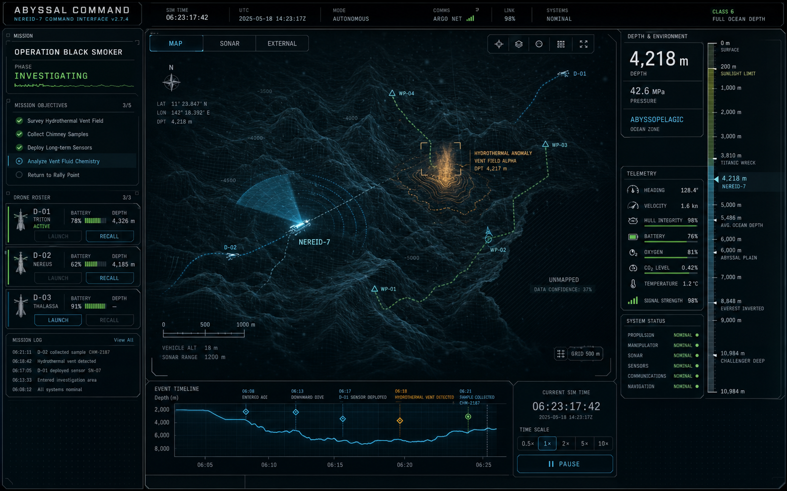
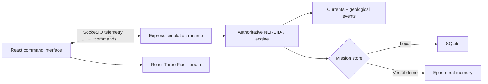

<div align="center">

# Abyssal Command

**A realtime deep-sea operations console for the NEREID-7 research vessel.**

[Live deployment](https://abyssal-command.vercel.app) · [Report a bug](https://github.com/hgarg1/abyssal-command/issues/new?template=bug_report.yml) · [Request an enhancement](https://github.com/hgarg1/abyssal-command/issues/new?template=feature_request.yml)

[](https://abyssal-command.vercel.app)
[](https://github.com/hgarg1/abyssal-command/actions/workflows/ci.yml)
[](LICENSE)
[](https://nodejs.org/)

</div>



> The image above is the original interface concept. Open the [live application](https://abyssal-command.vercel.app) for the production, interactive experience.

## Overview

Abyssal Command turns a browser into a submerged research control room. The operator pilots the fictional autonomous vessel **NEREID-7** through a server-authoritative ocean simulation, inspecting high-detail bathymetry, managing drones, tracking sonar contacts, and responding to geological events as the seabed deforms in realtime.

This is not a static dashboard. A Node.js simulation advances at 4 Hz and streams authoritative mission state to the React interface through Socket.IO.

## Highlights

- Interactive Three.js bathymetric terrain with pan, orbit, zoom, multiple views, high-detail rendering, and live geological deformation
- Server-simulated depth, pressure, heading, current, hull, life-support, sonar, mission, and drone telemetry
- Ocean-current vectors that stay aligned with the visualization as the camera pans
- Microquakes, vent eruptions, and slope failures that visibly reshape the mesh and enter the event timeline
- Functional depth navigation, panel controls, mission state, command palette, time controls, sonar inspection, and drone actions
- Local SQLite mission and telemetry history with a serverless-safe in-memory adapter for the hosted demo
- Responsive command-console presentation with motion, suspended particles, depth-dependent color, and bioluminescent accents

## Architecture



| Layer | Technology | Responsibility |
| --- | --- | --- |
| Interface | React, TypeScript, Framer Motion, Tailwind CSS | Mission control UI, panels, controls, and animation |
| Visualization | Three.js, React Three Fiber, Drei | Terrain, sonar, currents, vehicles, particles, and deformation |
| Realtime runtime | Node.js, Express, Socket.IO | Authoritative simulation, commands, REST endpoints, and telemetry |
| Persistence | Node SQLite / in-memory adapter | Durable local history and serverless demo compatibility |
| Tooling | Vite, Vitest, TypeScript | Development, compilation, and simulation validation |
| Hosting | Vercel Functions + Vercel CDN | Static interface and same-origin realtime backend |

## Run locally

### Prerequisites

- Node.js 22 or newer
- npm 10 or newer

### Setup

```bash
git clone https://github.com/hgarg1/abyssal-command.git
cd abyssal-command
npm install
npm run dev
```

Open `http://127.0.0.1:5173`. Vite proxies API and realtime traffic to the simulation server on port `3001`.

### Useful commands

| Command | Purpose |
| --- | --- |
| `npm run dev` | Start the client and simulation server in watch mode |
| `npm run test` | Run the simulation and command-parser test suite |
| `npm run build` | Type-check and generate the production frontend |
| `npm run check` | Run all tests followed by the production build |
| `npm start` | Serve the built app with the local Node runtime |

## Operator controls

- Drag to orbit the terrain; pan and zoom to inspect the survey area.
- Use the view toolbar to switch visualization layers and overlays.
- Select depth targets from the depth rail and issue mission commands from the side panels.
- Press `Ctrl` + `K` to open the natural-language command palette.
- Use the current indicator to track bearing relative to the panned visualization.

Example commands include `Descend to 5,200 m`, `Set heading 137`, `Launch Drone 3`, and `Focus sonar contact S-076`.

## API and realtime transport

| Endpoint | Method | Description |
| --- | --- | --- |
| `/api/health` | `GET` | Runtime health and persistence mode |
| `/api/state` | `GET` | Current authoritative simulation snapshot |
| `/api/missions` | `GET`, `POST` | Mission state access |
| `/api/history` | `GET` | Recent sampled telemetry |
| `/api/command` | `POST` | Structured or natural-language vessel command |
| `/api/realtime` | WebSocket / polling | Socket.IO telemetry and interactive commands |

## Deployment

The repository includes `vercel.json`, so a linked Vercel project can be deployed with:

```bash
vercel deploy --prod
```

The hosted portfolio demo uses an in-memory mission store because Vercel Functions do not provide durable local filesystem storage. Function instances can restart and realtime clients may reconnect after the configured 60-second maximum duration. Local development retains SQLite persistence. A production system that requires durable shared state should replace the memory adapter with managed Postgres or Redis.

## Project structure

```text
api/                  Vercel function entry points
docs/                 Portfolio imagery and project documentation
public/               Favicon, manifest, crawler, and social-preview assets
server/               Express runtime, simulation engine, and persistence
src/                  React interface, visualization, hooks, and styles
tests/                 Vitest simulation tests
vercel.json            Hosting, routing, caching, and function configuration
```

## Contributing and security

Contributions are welcome. Review [CONTRIBUTING.md](CONTRIBUTING.md) before opening a pull request. Please report security concerns using the private process in [SECURITY.md](SECURITY.md), not a public issue.

## License

Released under the [MIT License](LICENSE).
